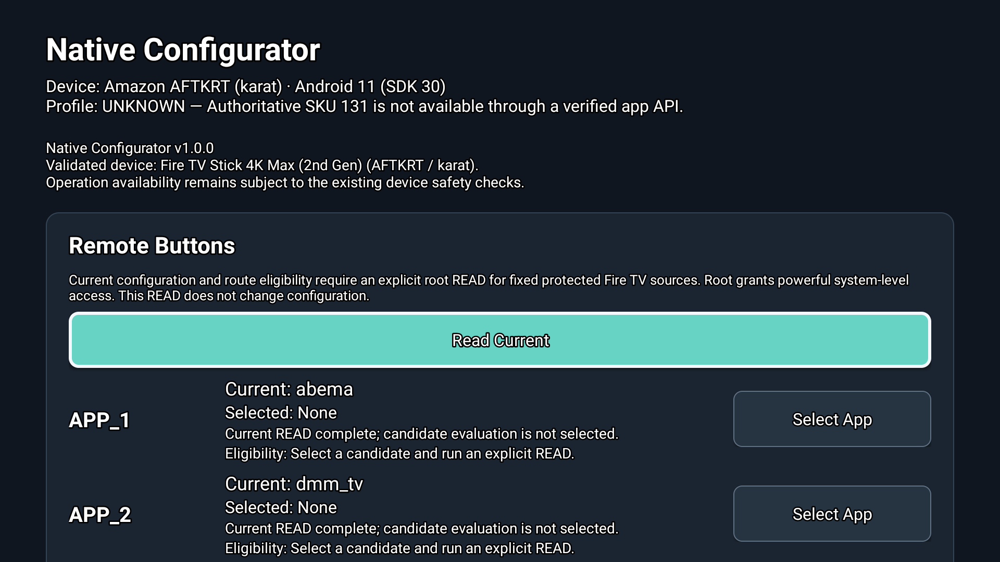
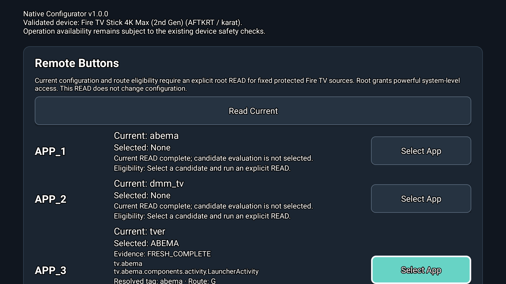
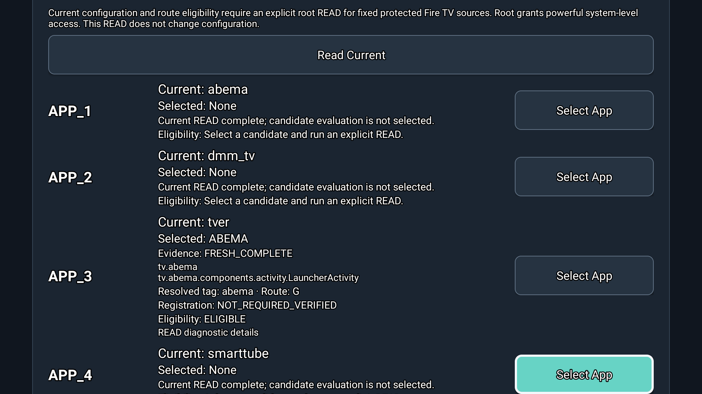
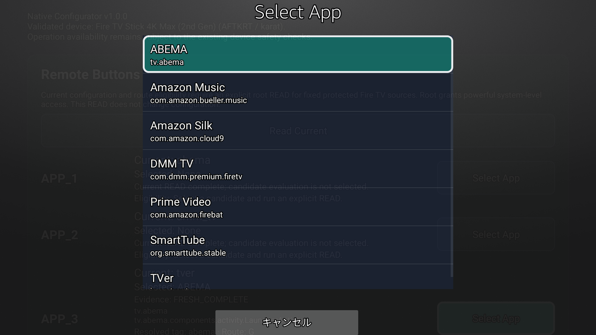
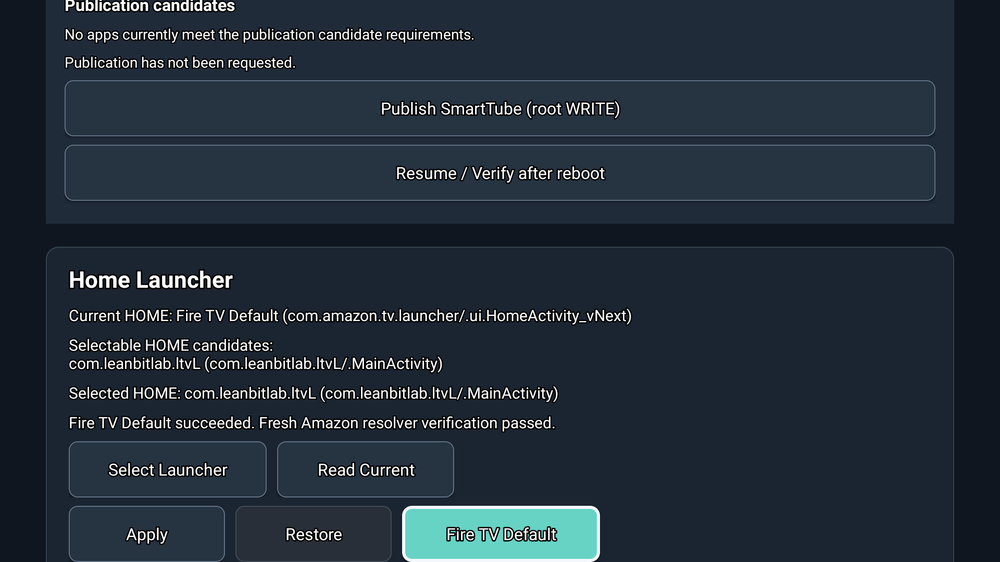
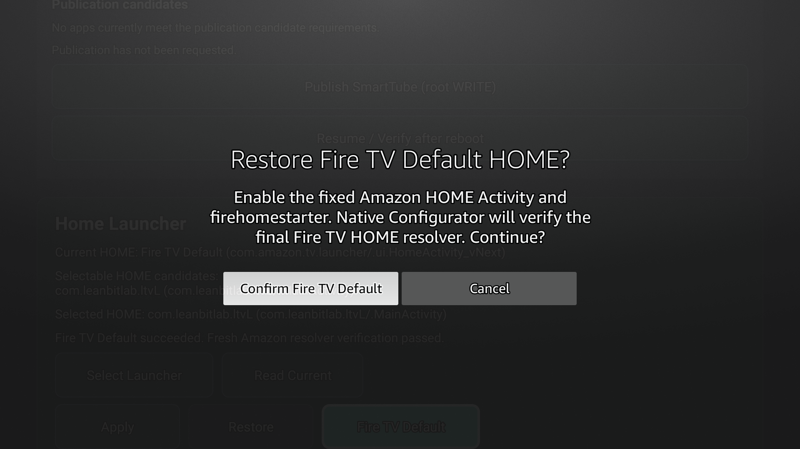
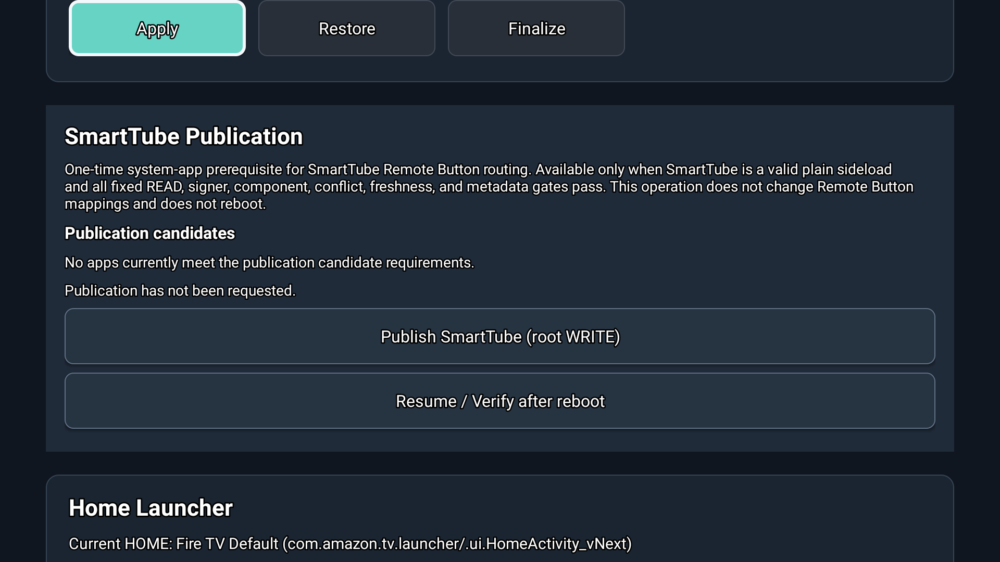

# Fire TV Native Configurator

A root-based GUI application for configuring Fire TV remote shortcut buttons and HOME launchers.

## Officially Supported Device

**Fire TV Stick 4K Max (2nd Generation) — AFTKRT / karat**

Tested on Fire OS 8.1.8.2.

Other models and Fire OS versions are not yet verified.

## Download

[Download Native Configurator v1.2.0](https://github.com/FIER-MONITOR01/FireTV-Native-Configurator/releases/tag/v1.2.0)

**Root access is required.**

## Features

- Remote Button Mapping: APP1–APP4
- Apply, Restore and Finalize for remote button changes
- HOME launcher selection and Fire TV Default recovery
- Publication for specifically verified application cases

## Install and Update

Download the signed Release APK from the link above. For a new installation:

```text
adb install Native-Configurator-v1.2.0.apk
```

For an existing installation signed with the same Release certificate:

```text
adb install -r Native-Configurator-v1.2.0.apk
```

Do not uninstall to work around a signature mismatch. Verify the SHA-256 in the Release Notes before installing. Allow root access when prompted.

## Remote Buttons

1. Open Remote Buttons and select **Read Current**.
2. Use **Select App** only for the APP1–APP4 assignments you want to change.
3. Select **Apply** and review the confirmation.

Unselected buttons automatically keep their current assignments. Choosing the current app does not create a change. If there are no changes, Apply does not rewrite settings or the backup.

Each successful Apply replaces the latest P backup with the P configuration immediately before that Apply. **Restore** restores that latest P backup and removes the backup after success. **Finalize** removes the backup while keeping the current configuration. Neither operation deletes A/G/N registrations.

A Fire TV restart may be required for the physical remote to use changed assignments. Read Current reads the device configuration directly, including after reinstalling the application.

See [v1.2.0 Release Notes](RELEASE_NOTES_v1.2.0.md) for changes and the APK SHA-256. Existing screenshots below may show an earlier interface.

## Screenshots

### Main Screen


### Remote Button Mapping



### App Selection


### HOME Launcher


### Confirmation


### Publication


## Beta Testing

Additional Fire TV models and Fire OS versions are not officially supported yet. Testing feedback is welcome.

## Source Code

Source code is not publicly available at this time.
